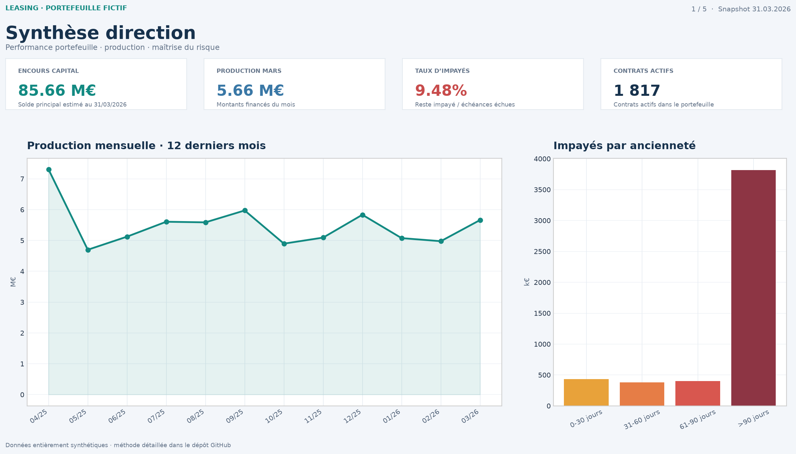
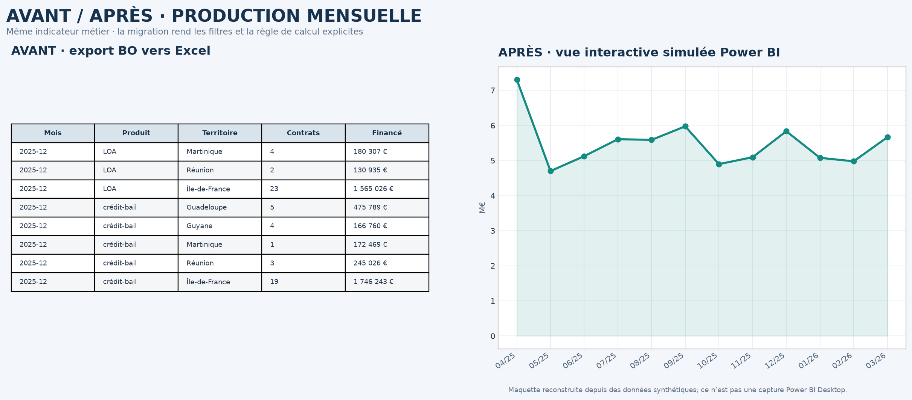
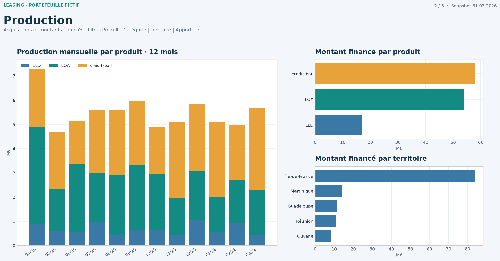
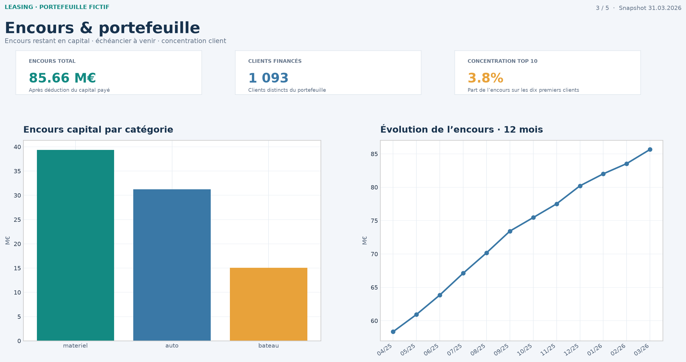
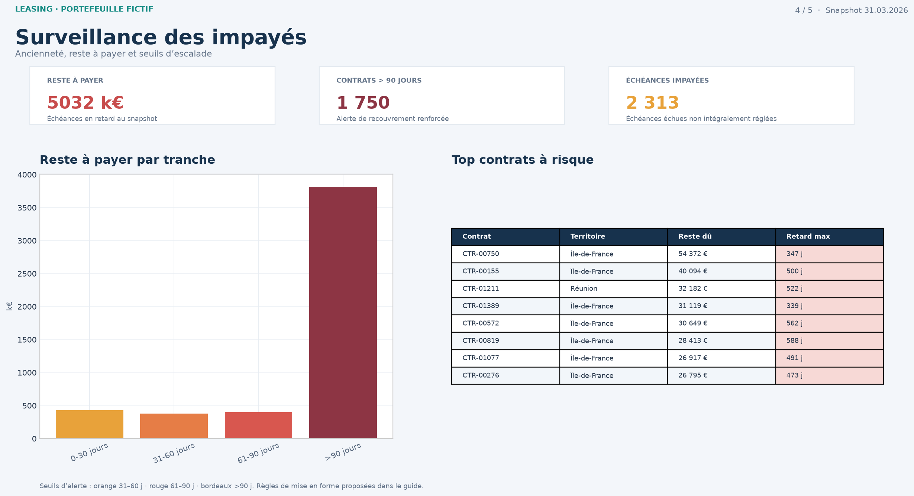
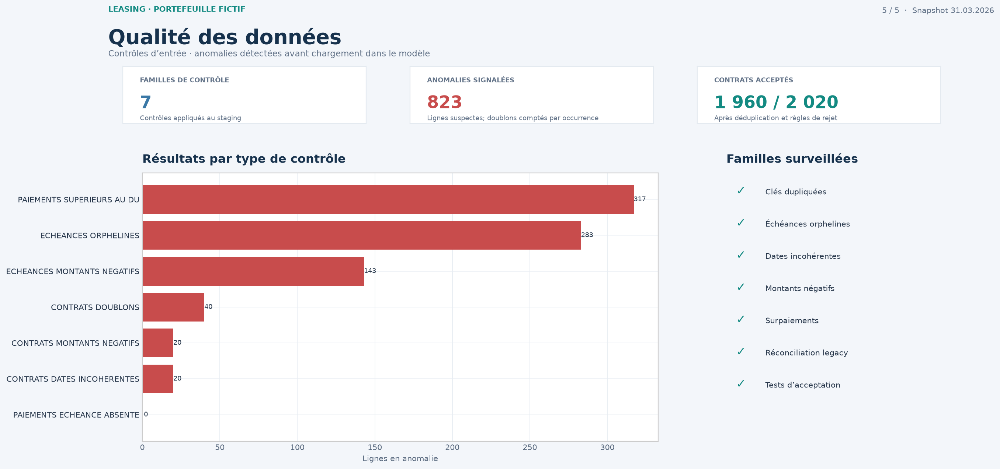

# Migration de reportings Excel / Business Objects vers Power BI — Leasing

**Créatrice : Fatma Hammami** · **Projet personnel — cas d’école synthétique**

Ce projet illustre l’analyse et la migration de trois reportings de gestion d’une société fictive de financement locatif (automobile, matériel d’équipement et bateaux) vers un modèle analytique destiné à Power BI. Toutes les données sont **synthétiques**, générées par Python; elles ne décrivent ni un client réel ni des travaux réalisés pour BRED Cofilease. Les « états Business Objects » sont des **reproductions au format Excel/CSV** : BusinessObjects n’est pas disponible en open source et aucune capture ou extraction BO authentique n’est revendiquée.



## Avant / après

L’export de type BO ci-dessous est reproduit à partir du staging brut. La vue de droite montre le rendu cible avec le périmètre SQL nettoyé. Les écarts du staging sont expliqués dans le [cahier de recette](docs/cahier_de_recette.md).



> **Transparence Power BI :** les cinq PNG sont des maquettes statiques calculées depuis les données synthétiques — pas des captures de Power BI Desktop. Le fichier natif `powerbi/Reporting_Leasing.pbix` n’est pas fourni, Power BI Desktop n’étant pas disponible dans cet environnement Linux. Le pack de reconstruction inclut le schéma, le DAX, un exemple Power Query et les consignes pour créer/enregistrer le PBIX dans Power BI Desktop.

## Démarche de migration

1. **Analyse de l’existant :** description des trois sorties legacy, de leurs règles, limites et équivalences cible dans [`docs/analyse_existant.md`](docs/analyse_existant.md).
2. **Modèle SQL :** données en staging, contrôles de qualité, tables contraintes et vues de production, encours et impayés dans [`sql/`](sql/).
3. **Migration Power BI :** proposition de modèle en étoile, mesures DAX et cinq maquettes de pages dans [`powerbi/`](powerbi/) et `docs/screenshots/`.
4. **Recette :** quinze cas documentés et résultats reproductibles dans [`docs/cahier_de_recette.md`](docs/cahier_de_recette.md) et [`recette/recette_resultats.xlsx`](recette/recette_resultats.xlsx).
5. **Déploiement et maintenance :** procédure cible, rôles, surveillance et checklist de montée de version dans [`docs/guide_maintenance.md`](docs/guide_maintenance.md).

## Résultats du scénario de démonstration

Sur l’exécution déterministe fournie :

- **2 000 contrats** générés et **24 mois** d’historique (avril 2024 à mars 2026), avec échéanciers et paiements;
- **1 960 contrats** chargés dans le périmètre décisionnel après déduplication et rejet des lignes de contrat invalides;
- **3 reportings legacy** reproduits dans Excel;
- **7 contrôles SQL** et **823 occurrences/anomalies détectées** dans le jeu d’exercice (les deux occurrences d’une clé dupliquée sont comptées); détails dans [`data/controles_qualite.csv`](data/controles_qualite.csv);
- **2 écarts de migration documentés et corrigés** : lignes brutes affectant les regroupements de production, et calcul d’encours legacy qui retranchait les intérêts du principal;
- **15 cas de recette** : 13 contrôles de données/calcul documentés comme réussis et 2 essais d’interaction/actualisation restant à valider dans Power BI Desktop;
- **5 maquettes de pages** générées depuis les vues de données : synthèse, production, encours, impayés et qualité.

Les anomalies sont volontaires et servent à montrer les contrôles, elles ne représentent pas une mesure de qualité d’un portefeuille réel.

## Aperçus des cinq pages

### 1. Synthèse direction


### 2. Production


### 3. Encours et portefeuille


### 4. Surveillance des impayés


### 5. Qualité des données


## Reproduire localement

Python 3.10+ est recommandé. Depuis la racine du dépôt :

```bash
python3 -m venv .venv
.venv/bin/python -m pip install -r requirements.txt
.venv/bin/python scripts/generate_data.py
.venv/bin/python scripts/build_project.py
.venv/bin/python -m pytest -q
```

La commande `bash scripts/run_demo.sh` effectue ces étapes en une fois. La base [`data/leasing_demo.sqlite`](data/leasing_demo.sqlite) contient le staging de contrôle et le mart nettoyé. Le script de génération peut être relancé avec `--seed` et `--contracts` pour produire un scénario différent; le paramètre par défaut est déterministe.

## Structure

```text
scripts/                 génération, construction des livrables et tests
 data/                   CSV synthétiques bruts, contrôles et mart SQLite
sql/                     schéma, vues et contrôles de qualité
legacy_reports/          trois reproductions Excel « avant »
powerbi/                 mesures DAX, exemple Power Query et guide de reconstruction
recette/                 résultats de 15 cas de recette au format Excel
docs/                    analyse, recette, maintenance et maquettes PNG
```

## Outils et portabilité

**Python** (pandas, NumPy, Faker, openpyxl, Matplotlib), **SQLite**, SQL, **Excel**, Power BI Desktop (reconstruction à effectuer), **DAX**, Power Query et Git. Les types, jointures, agrégations, expressions `CASE`/`COALESCE` et règles des vues privilégient un SQL transposable à PostgreSQL, DB2 ou Oracle. Le DDL, les types de dates et certaines syntaxes de création de vues doivent être adaptés au SGBD visé; le dépôt ne promet pas une compatibilité binaire sans ajustement.

Le code du projet est sous licence MIT. Les données sont créées par le générateur fourni et sont fictives; voir [`LICENSE`](LICENSE) et [`data/README.md`](data/README.md).
